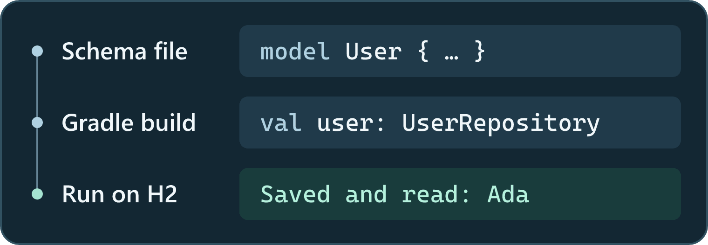
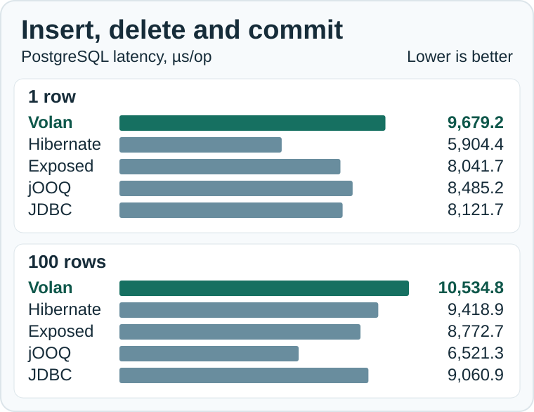

<p align="center">
  
</p>

<h1 align="center">Volan</h1>

<p align="center">Volan is an ORM that generates a type-safe database client for Kotlin and Java from a schema file.</p>

<p align="center">
  <a href="#try-volan">Try Volan</a> &nbsp;&nbsp;
  <a href="https://volan.mintlify.app/en/introduction">Documentation</a> &nbsp;&nbsp;
  <a href="https://volan.mintlify.app/ru/introduction">Документация</a>
</p>

<p align="center">
  <a href="https://github.com/thirtyeighttwentysix/volan/actions/workflows/ci.yml"></a>
</p>



## Try Volan

You need JDK 17 or newer and a checkout of this repository. The example uses embedded H2 and
Volan 1.0.0 from Maven Central. These commands generate the client, run the tests and start the
app. From the repository root on macOS or Linux, use the shell wrapper.

```bash
./gradlew -p examples/kotlin-basic test run
```

In Windows PowerShell, use the batch wrapper.

```powershell
.\gradlew.bat -p examples/kotlin-basic test run
```

The app applies the example's SQL migration, then saves and reads a user in one transaction.
Look for `Saved and read: Ada` in the output.

<a name="the-idea"></a>
<a name="what-makes-it-different"></a>

## From schema to query

The Gradle plugin reads `schema.volan` before compilation and generates the client and row
mappers for your models. The app uses that client to run queries over JDBC.

In the example, `openDatabase` applies the migration and opens a `VolanClient` for this function.
[See the full Kotlin program](examples/kotlin-basic/src/main/kotlin/example/Main.kt).

```kotlin
import example.generated.User
import example.generated.VolanClient

fun insertAndRead(db: VolanClient, name: String): User =
    db.transaction { tx ->
        val created = tx.user.create { this.name = name }
        tx.user.findFirstOrThrow {
            where { id eq created.id }
        }
    }
```

The generated `user` repository inserts the name and returns the row with its assigned ID. Volan
uses the ID in this H2 query to read the same row back.

```sql
SELECT "t0"."id", "t0"."name"
FROM "User" AS "t0"
WHERE "t0"."id" = ?
LIMIT ?
```

JDBC binds the new ID and a limit of one row. The function returns the saved `User`.

## Examples

- [Run the Kotlin example with a generated client and a migration](examples/kotlin-basic/README.md).
- [Run the same transaction from Java](examples/java-basic/README.md).
- [Use constructor injection in a Spring Boot app](examples/spring-boot/README.md).
- [Query a database from a Ktor route](examples/ktor/README.md).

<a name="maven-central"></a>

## Set up a project

Use the Gradle or Maven plugin to generate the client during the build. In a Java project, enable
`javaFriendly` in the schema and compile the generated Kotlin sources with the Kotlin compiler.
See the [Gradle and Maven setup for Volan 1.0.0](docs/build-plugins.md).

<a name="supported-databases"></a>

Volan 1.0.0 supports PostgreSQL, SQLite, H2, MySQL and MariaDB. The matrix lists the types,
query features and migration behavior for each provider. [Check database support](docs/dialects.md).

<a name="migrations"></a>

Apply migrations as a separate step to create or change tables. For existing databases, the CLI
can read the schema back into a `.volan` file. [Plan and apply database changes](docs/migrations.md).

<a name="install-the-cli--установка-cli"></a>

The CLI runs on Windows, Linux and macOS with Java 17 or newer. The installer adds `volan` to
your user `PATH`. [Install the CLI / Установка CLI](docs/cli-installation.md).

<a name="orm-and-sql-library-comparison"></a>

## Measured performance

The 14 November 2026 PostgreSQL benchmark measures the optimization on `main` after 1.0.0.
With four concurrent readers fetching 100 rows each, Volan averaged **1.80 ms per operation**,
down from 2.58 ms before the change on the same machine. JDBC was next at 2.22 ms.


JDBC had the lowest mean latency in both single-thread read cases. Write latency varied widely.
[Read the benchmark setup, before/after data and reproduction steps](benchmarks/README.md).

<details>
<summary>All 40 results and three more charts</summary>

<!-- BENCHMARKS:START -->

**Read, one thread**

| Library | 1 row, µs/op | 100 rows, µs/op |
|---|---:|---:|
| **Volan** | 1898.6 ± 374.4 | 2123.6 ± 100.0 |
| Hibernate | 2041.8 ± 311.6 | 2367.0 ± 144.7 |
| Exposed | 2751.9 ± 197.7 | 3075.4 ± 286.6 |
| jOOQ | 2039.2 ± 253.5 | 2200.0 ± 158.2 |
| JDBC | 1787.5 ± 116.7 | 2009.3 ± 136.2 |

**Read, four threads**

| Library | 1 row, µs/op | 100 rows, µs/op |
|---|---:|---:|
| **Volan** | 1851.1 ± 444.8 | 1800.1 ± 106.1 |
| Hibernate | 1858.3 ± 297.6 | 2619.6 ± 523.3 |
| Exposed | 3063.1 ± 362.8 | 3145.7 ± 149.0 |
| jOOQ | 2098.3 ± 192.2 | 2267.1 ± 199.8 |
| JDBC | 2172.9 ± 365.7 | 2216.0 ± 192.6 |

**Update and commit**

| Library | 1 row, µs/op | 100 rows, µs/op |
|---|---:|---:|
| **Volan** | 5844.5 ± 4267.6 | 6445.3 ± 4334.9 |
| Hibernate | 7409.8 ± 4482.6 | 5385.0 ± 919.6 |
| Exposed | 8264.9 ± 4849.7 | 5715.2 ± 344.4 |
| jOOQ | 7549.3 ± 4925.8 | 7384.7 ± 4977.0 |
| JDBC | 4860.7 ± 2288.2 | 7874.5 ± 4748.9 |

**Insert, delete and commit**

| Library | 1 row, µs/op | 100 rows, µs/op |
|---|---:|---:|
| **Volan** | 9679.2 ± 4005.1 | 10534.8 ± 3658.6 |
| Hibernate | 5904.4 ± 417.4 | 9418.9 ± 3740.1 |
| Exposed | 8041.7 ± 3142.3 | 8772.7 ± 2922.0 |
| jOOQ | 8485.2 ± 4720.0 | 6521.3 ± 389.2 |
| JDBC | 8121.7 ± 4915.7 | 9060.9 ± 4462.2 |

<!-- BENCHMARKS:END -->

The chart bars show means. The tables also give JMH's 99.9% confidence margins. Volan allocated
32% fewer bytes per 100-row insert/delete transaction than before the optimization.
[See the raw measurements and machine metadata](benchmarks/results/).




</details>

## Documentation

- [Define models, fields and relations in a Volan schema](docs/schema-language.md).
- [Write Java queries and transactions with the generated client](docs/java-api.md).
- <a name="coroutines-and-observability"></a>[Run queries in coroutines and measure query latency](docs/coroutines-and-observability.md).
- [See project milestones and current limitations](ROADMAP.md#deliberately-deferred).

<a name="building-from-source"></a>

For contributors, see [how to build and test Volan](CONTRIBUTING.md) and
[how the modules fit together](ARCHITECTURE.md).

<a name="support-development--поддержать-разработку"></a>

## Support development

Donations give me more time to support databases, write tests and improve the docs.

Поддержка помогает мне уделять больше времени базам данных, тестам и документации.

[Donate via CloudTips](https://pay.cloudtips.ru/p/b05a329d) &nbsp;&nbsp; [Поддержать через CloudTips](https://pay.cloudtips.ru/p/b05a329d)

<details>
<summary>Crypto wallets / Криптокошельки</summary>

| Asset / Валюта | Network / Сеть | Wallet address / Адрес кошелька |
|---|---|---|
| **GRAM** | TON | `UQAIjKkz-_UKju3uxH_ixEbk_10ha_qNl8LwHM7rwLVYlWdD` |
| **USDT (Tether)** | TRON (TRC20) | `TArsteJh5PmWk9qzY3rhE5L8L1znVhZt3E` |
| **SOL** | Solana | `EGGK8uTCYc7YDorXHLUzZQduj3zubzuiXYU2wKY2ii8W` |

</details>

## Licence

[Apache License 2.0](LICENSE).
